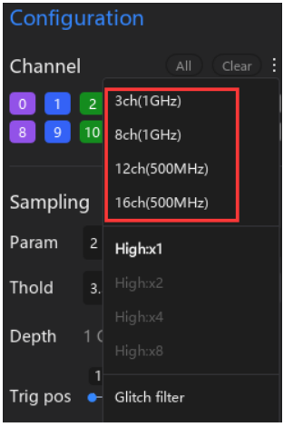

# ATK-Logic — Guia prático e anotações de uso

> Repositório em PT-BR com dicas, materiais de estudo e arquivos de exemplo para tirar o máximo do analisador lógico **ATK-Logic (ALIENTEK)**.



---

## 📋 Sumário

- [Por que este repositório existe?](#por-que-este-repositorio-existe)
- [Estrutura dos conteúdos](#estrutura-dos-conteudos)
- [Primeiros passos](#primeiros-passos)
- [Conceitos-chave sem enrolação](#conceitos-chave-sem-enrolacao)
- [Receitas rápidas por protocolo](#receitas-rapidas-por-protocolo)
- [Regras de bolso](#regras-de-bolso)
- [Dúvidas comuns e troubleshooting](#duvidas-comuns-e-troubleshooting)
- [Roadmap & contribuição](#roadmap-contribuicao)
- [Licença](#licenca)

---

<a id="por-que-este-repositorio-existe"></a>
## 🎯 Por que este repositório existe?

Este espaço serve como um **manual vivo** para quem trabalha com o ATK-Logic e precisa de referências rápidas:

- Centraliza **anotações**, **capturas de tela** e links úteis.
- Organiza **exemplos de captura** (`*.atklog`) para estudo ou demonstração.
- Reúne explicações objetivas sobre **taxa de amostragem**, **depth**, **trigger** e **modos de aquisição**.
- Fornece **passos guiados** para protocolos comuns (UART, I²C, SPI, PWM), reduzindo tentativa-e-erro.

> **Meta**: ser um “cheat sheet” completo, sempre atualizado com o que realmente faz diferença no uso diário do analisador.

---

<a id="estrutura-dos-conteudos"></a>
## 🗂️ Estrutura dos conteúdos

```
atk-logic-notes/
├── README.md                 # visão geral e atalhos rápidos
├── LICENSE                   # licença MIT
├── docs/
│   ├── 1.Conceitos_Fundamentais/  # sampling, depth, trigger, modos e glossário
│   ├── 2.Funcoes_do_Software/     # guias passo a passo da interface
│   ├── 3.Apoio_Extras/            # troubleshooting, receitas e roadmap
│   └── assets/                    # imagens de apoio usadas nos docs
└── examples/               # capturas .atklog organizadas por protocolo
    ├── i2c/
    ├── pwm/
    ├── spi/
    └── uart/
```

Cada pasta tem um `README` (ou arquivo índice) explicando como aproveitar o conteúdo e quais materiais ainda precisam ser adicionados. Caso crie pastas novas (ex.: `screenshots/`), siga o mesmo padrão de documentação curta + exemplos.

---

<a id="primeiros-passos"></a>
## 🚀 Primeiros passos

| Etapa | O que fazer | Por quê importa |
| --- | --- | --- |
| 1. Conecte o hardware | Plugue o analisador via USB e confirme o reconhecimento pelo SO. | Sem drivers ok? Sem captura. |
| 2. Abra o ATK-Logic | Menu direito **Configuration** é onde tudo começa. | Organização visual do setup. |
| 3. Configure **Channel** | Habilite os canais relevantes e nomeie-os. | Facilita identificação posterior. |
| 4. Ajuste **Sampling** | Defina taxa (ex.: 20 MHz), janela (500 ms) e níveis lógicos. | Determina resolução e alcance temporal. |
| 5. Defina **Trigger** | Escolha borda, nível ou evento de protocolo. | Captura o momento certo sem loteria. |
| 6. Selecione o **Mode** | **Buffer** para fidelidade; **Stream** para monitorar tempo real. | Equilíbrio entre dados e largura de banda. |
| 7. Capture & salve | Aperte **Run/Capture** e salve em `examples/`. | Cria histórico reutilizável. |

> 💡 **Dica:** Para treinar sem hardware, ative o modo **Demo**. Dá para praticar zoom, medidas e triggers com sinais fictícios.

---

<a id="conceitos-chave-sem-enrolacao"></a>
## 📚 Conceitos-chave sem enrolação

### Taxa de amostragem (Sampling rate)

Quantas “fotos” por segundo o ATK-Logic tira do sinal (ex.: 20 MHz = 20 milhões de amostras/s).

- **Nyquist**: amostre ≥ 2× a maior frequência.
- **Prática em digitais**: 5–10× a frequência ou a resolução desejada na borda.

### Depth (profundidade de memória)

Indica quantas amostras por canal cabem no buffer. Com a taxa de amostragem, define **quanto tempo** cabe na captura.

> Exemplo: 10 MSa/ch a 20 MHz ⇒ 0,5 s de janela por canal.

### Trigger

Condição que inicia a captura (borda, nível, padrão, evento de protocolo). Ajuda a congelar **exatamente o trecho** que importa.

### Modes — Buffer vs Stream

- **Buffer**: captura fechada de alta fidelidade; ideal para analisar pacotes completos.
- **Stream**: fluxo contínuo para o PC; ótimo para monitoramento, mas pode limitar a taxa efetiva por causa da USB.

### Demo & File open

- **Demo**: gera sinais fictícios para treino e demonstrações.
- **File open**: reabre capturas salvas para revisão ou material didático.

---

<a id="receitas-rapidas-por-protocolo"></a>
## 🔧 Receitas rápidas por protocolo

### UART (TTL 3.3 V)

1. **Sampling**: 10–20× a *baud rate* (ex.: 1–2 MHz para 115200 bps).
2. **Channels**: RX (e TX, se disponível).
3. **Trigger**: borda de descida (start bit) ou byte específico via decoder.
4. **Decode**: configure baud, 8N1 etc., e habilite o decodificador UART.

### I²C (100 k / 400 k / 1 M)

1. **Sampling**: ≥ 10× a frequência (ex.: 4–10 MHz em 400 kHz).
2. **Channels**: SDA e SCL.
3. **Trigger**: condição de start; opcionalmente endereço do slave.
4. **Decode**: confira *pull-ups* e níveis antes de ativar o decodificador.

### SPI (1–20 MHz típ.)

1. **Sampling**: ≥ 5–10× da frequência do clock SPI.
2. **Channels**: SCK, MOSI, MISO, CS.
3. **Trigger**: borda de CS ou comando relevante.
4. **Decode**: selecione modo (CPOL/CPHA) e ordem de bits correta.

### PWM (medidas de duty/período)

1. **Sampling**: garanta ≥ 10 pontos por período.
2. **Trigger**: borda de subida.
3. **Measure**: use cursores para largura de pulso, período e duty cycle.

> **Observação:** As recomendações acima visam **visualização e medição** estáveis. Para simples detecção de eventos, Nyquist (2×) pode bastar; para metrologia de borda, mantenha 5–10×.

---

<a id="regras-de-bolso"></a>
## 🧮 Regras de bolso

- **Resolução temporal** ≈ 1 / (taxa de amostragem). Ex.: 20 MHz ⇒ 50 ns.
- **Janela de captura** ≈ depth / taxa de amostragem.
- **Pontos por período** ≈ taxa de amostragem / frequência do sinal.

---

<a id="duvidas-comuns-e-troubleshooting"></a>
## 🐞 Dúvidas comuns e troubleshooting

- **Nada aparece**: confirme *Channel* habilitado, nível lógico (*Thold*) correto (3.3 V / 5 V) e referência GND comum.
- **Sinal flutuando**: adicione resistores *pull-up/down* apropriados.
- **Decode incorreto**: revise *baud rate* (UART), CPOL/CPHA (SPI) e *pull-ups* (I²C).
- **Perda em Stream**: reduza taxa de amostragem ou alterne para **Buffer**.

---

<a id="roadmap-contribuicao"></a>
## 🛣️ Roadmap & contribuição

- [ ] Adicionar exemplos reais (UART/I²C/SPI/PWM) em `examples/`.
- [ ] Print screens anotados em `screenshots/`.
- [ ] Docs detalhados (`sampling`, `depth`, `trigger`, `modes`, `demo-fileopen`).
- [ ] Tabela comparativa de “taxa de amostragem recomendada” por protocolo.

Quer ajudar?

1. Abra uma **issue** com sugestão ou dúvida.
2. Crie um **pull request** com novos arquivos de captura ou melhorias na documentação.
3. Utilize o **modo Demo** para gerar screenshots e adicionar comentários na pasta `screenshots/`.

---

<a id="licenca"></a>
## 📝 Licença

Distribuído sob licença **MIT** — simples, permissiva e ideal para compartilhar conhecimento. Veja detalhes no arquivo [`LICENSE`](LICENSE).
